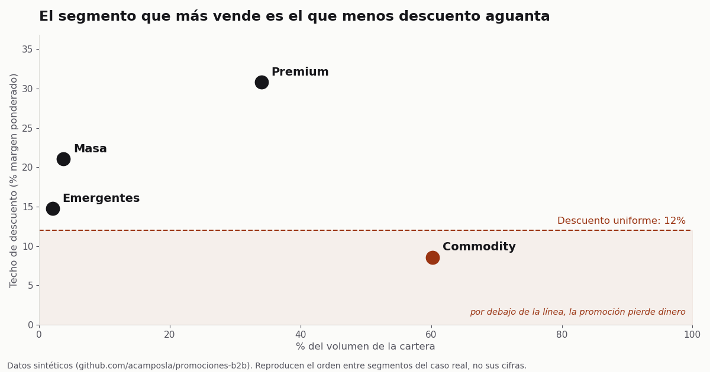

# Promociones B2B: el techo de descuento de cada grupo de clientes

Un distribuidor B2B da la misma promoción a todos sus clientes. Este repo calcula, a partir de la
facturación, cuánto descuento aguanta cada grupo de clientes antes de perder dinero, y diseña un
rappel por crecimiento que solo descuenta sobre lo que el cliente crece.

El hallazgo del caso: **el grupo que más volumen suma es el que menos descuento aguanta.** Con un
descuento igual para todos, la promoción pierde dinero justo donde está la mayor parte del negocio.



El caso contado, con el contexto de negocio y las decisiones:
[El grupo que más compra es el que menos descuento aguanta](https://alejandrocamposlamas.com/portfolio/el-grupo-que-mas-compra/).
El caso es el de Garza, la marca propia de iluminación, conectividad e IoT de Imprex, que dirigí
entre 2020 y 2026.

> **English summary.** Reproducible pipeline that turns B2B invoice lines into a customer table,
> segments it into four groups with K-Means, translates the groups into three-level decision
> rules for the sales team, and computes a discount ceiling per group (its volume-weighted
> margin). It also models a growth rebate, `net = r · u · V · (m − d)`, whose sign depends only on
> the discount versus the ceiling. All data is synthetic and generated with a fixed seed.

## Los datos son sintéticos

Ningún dato de este repo viene de Imprex, de Garza ni de sus clientes. `promociones/datos.py`
genera líneas de factura de un distribuidor ficticio con una semilla fija. Imita la forma de una
cartera real (cola larga de volumen, margen independiente del tamaño, un grupo pequeño que crece
deprisa) y conserva el orden entre grupos del caso real, pero no sus cifras: el número de
clientes, el reparto del volumen y los márgenes son inventados.

## Qué hace, paso a paso

| Paso | Dónde | Qué decide |
|---|---|---|
| Líneas de factura | `promociones/datos.py` | 1.285 clientes, dos años de pedidos con importe y coste |
| Una fila por cliente | `sql/abt_clientes.sql` | Volumen, frecuencia (pedidos, no líneas), ticket medio, margen %, categorías y tendencia frente al año anterior |
| Cuatro grupos | `promociones/segmentar.py` | Log en las variables de cola larga, escalado por mediana e IQR, K-Means con k=4 elegido por criterio comercial |
| Reglas para ventas | `promociones/segmentar.py` | Árbol de decisión de tres niveles en unidades de negocio (€, pedidos, %) |
| Techo y rappel | `promociones/techo.py` | Margen ponderado por grupo, rejilla grupo × cuartil y neto del rappel |
| El caso entero | `notebooks/caso.ipynb` | Todo lo anterior, ejecutado y comentado |
| Simulador | `scripts/simulador_web.py` | Página autónoma (HTML y JS, sin dependencias) para mover crecimiento, descuento y aceptación por grupo y cuartil |

Dos decisiones que el código deja a la vista:

- **Cuatro grupos aunque la estadística no los elija.** En estos datos la silueta prefiere tres
  grupos. Con dos o con tres, los clientes grandes de margen alto y los de margen estrecho caen
  juntos, y necesitan ofertas opuestas. El notebook lo enseña con el reparto del volumen de cada
  grupo cuando se fuerza k=2 y k=3, y un test lo comprueba.
- **El techo no necesita datos de campañas.** Si el descuento es igual al margen ponderado del
  grupo, el neto del rappel es cero acepte quien acepte. La tasa de respuesta decide cuánto se gana;
  el descuento decide si se gana.

## Cómo ejecutarlo

Requiere Python 3.10 o posterior. El SQL corre sobre SQLite, que viene con Python.

```bash
git clone https://github.com/acamposla/promociones-b2b.git
cd promociones-b2b
python -m venv .venv && source .venv/bin/activate
pip install -e ".[dev]"

pytest                                # 16 comprobaciones, unos 7 segundos
python scripts/construir_notebook.py  # reescribe y ejecuta notebooks/caso.ipynb
python scripts/figura.py              # regenera docs/techo-frente-a-volumen.png
python scripts/simulador_web.py docs/simulador.html     # regenera el simulador
python scripts/simulador_web.py docs/simulator.html en  # versión en inglés
python -m promociones.datos datos/facturas.csv   # exporta las facturas a CSV
```

Los tests comprueban que el generador es reproducible, que el SQL da lo mismo que una versión en
pandas, que el neto del rappel es cero en el techo y que el hallazgo se sostiene: el grupo con más
volumen tiene el techo más bajo y, con menos de cuatro grupos, Premium y Commodity van juntos.

El simulador está publicado dentro del caso, en la web. Sustituye al simulador de Power BI
del caso real, que no se puede enseñar porque lleva los datos reales dentro del fichero.

## Diferencias con el caso real

- En el caso real, el volumen era la facturación bruta y el margen salía de la venta neta menos
  el coste. Aquí las dos cosas salen del mismo importe.
- En el caso real había abonos que dejaban bases negativas; la consulta las trata como un
  cliente sin base (tendencia 1). El generador solo produce importes positivos.
- Los umbrales de la rejilla y los escenarios del rappel son parámetros de diseño elegidos para
  este ejemplo.

## Lo que no hace

- **No mide el efecto de una promoción.** La factura no dice a quién se le ofreció y no compró. Para
  medirlo hace falta un piloto con grupo de control, apuntando antes de lanzar a quién se le ofrece.
- **No valida el clustering con el árbol.** El árbol aprende de las mismas variables que formaron
  los grupos; su acierto describe qué tan bien se resumen en reglas, nada más.
- **No es el código del caso real.** Es una reescritura limpia del método sobre datos sintéticos.

## Licencia

MIT. Ver `LICENSE`.
